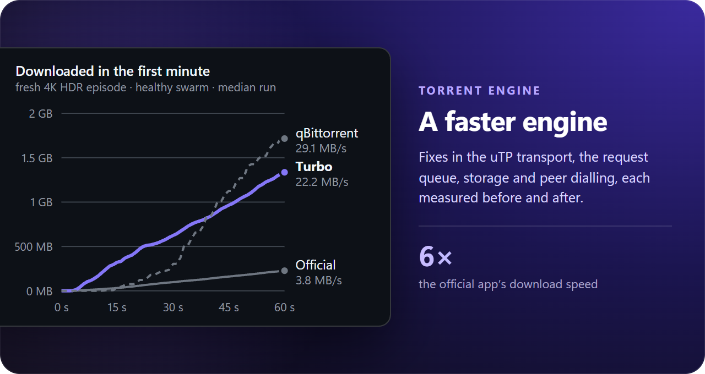
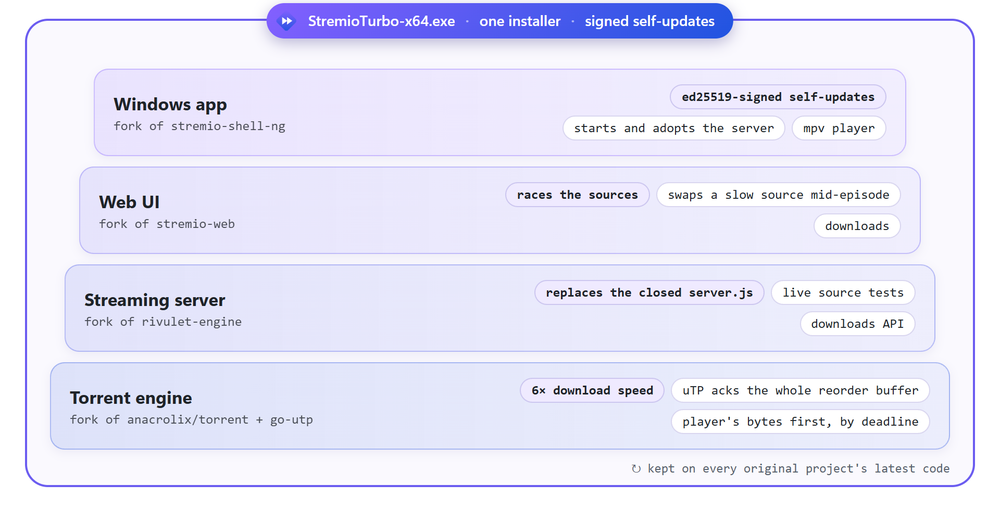

<!-- DRAFT (branch `readme`): images from scripts/readme-images.mjs; numbers from research/lab/bench (2026-11-22). -->

<p align="center">
  
</p>

<p align="center">
  <b>Stremio for Windows, rebuilt for speed.</b><br>
  It races the sources and plays the fastest one that keeps up, on a faster open-source torrent engine.
</p>

<p align="center">
  <a href="https://github.com/brunokinast/stremio-turbo/releases/latest"></a>
  <a href="https://github.com/brunokinast/stremio-turbo/actions/workflows/release.yml"></a>
  
  
</p>

<hr>

<p align="center">
  <a href="https://github.com/brunokinast/stremio-turbo/releases/latest/download/StremioTurbo-x64.exe"></a>
</p>

<p align="center"><sub>Windows Defender may flag the installer: it isn't code-signed yet. The app updates itself, and every update is verified.<br><a href="#how-its-built">How it's built ↓</a></sub></p>

<hr>

<br>

## Features

<picture>
  <source media="(prefers-color-scheme: dark)" srcset="docs/readme/card-race-dark.gif">
  
</picture>

<picture>
  <source media="(prefers-color-scheme: dark)" srcset="docs/readme/card-engine-dark.png">
  
</picture>

<picture>
  <source media="(prefers-color-scheme: dark)" srcset="docs/readme/card-resume-dark.gif">
  
</picture>

<picture>
  <source media="(prefers-color-scheme: dark)" srcset="docs/readme/card-downloads-dark.gif">
  
</picture>

<br>

## How fast

<picture>
  <source media="(prefers-color-scheme: dark)" srcset="docs/readme/stats-dark.png">
  
</picture>

On a thin swarm (about 14 seeders) Turbo starts in **5.0 s** against the official app's 16.7 s, and the official app never started in 1 run of 3.

<sub>Median of 3 runs per client, each starting fresh with nothing cached, in rotating order; the same player (the app's mpv) plays for Stremio and Turbo. qBittorrent has no player: its line is the same torrent downloading. Script and raw numbers: [research/lab/bench](research/lab/bench).</sub>

<br>

## How it's built

Every layer of Stremio, forked, improved and bundled into one installer.

<picture>
  <source media="(prefers-color-scheme: dark)" srcset="docs/readme/stack-dark.png">
  
</picture>

**A few decisions worth a look**

- **Fix the cause in the layer that owns it.** No patch scripts or runtime workarounds: each change is a normal commit in its fork. ([UPSTREAMS.md](UPSTREAMS.md))
- **Prove it in a lab first.** A 150 ms relay with a real libtorrent sender showed uTP's 30-packet selective ack freezing a stream once per lost packet; acking the whole reorder buffer removed it. ([lab](research/findings/10-lab-results.md), [fix](research/findings/12-transport-fixes.md))
- **Only the player's bytes are urgent.** The chunks mpv needs are asked for first, by deadline, and taken from a slow peer once overdue. ([start-up reads](research/findings/14-startup-reads.md), [critical chunks](research/findings/15-critical-chunks.md))
- **One health rule for every choice.** 1.25× playback speed picks the source, prepares the next episode, triggers a switch and chooses download sources. ([the picker](research/findings/36-one-picker-next-slot-switching.md))

**Always ahead of the official app.** A release can't be built until every original project's latest code is merged and every test passes ([scripts/release.ps1](scripts/release.ps1)).

**Quality.** About 2,200 tests (Jest, Go, Rust) before every commit; 44 findings documents with before-and-after numbers.

**Stack.** Go · Rust · React · TypeScript · WebView2 · mpv · anacrolix/torrent · Inno Setup · GitHub Actions

<br>

## Build it

Needs Node.js 24 (corepack), Go, Rust (MSVC) and Inno Setup 6.

```
pwsh scripts/build.ps1           # installer and signed update files in out/
pwsh scripts/dev.ps1             # the app against the web dev server
pwsh scripts/sync-upstreams.ps1  # merge every original project's latest code
```

Each folder keeps its project's licence: `web/` GPL-2.0, `server/` MIT, `deps/` MPL-2.0; `shell/` comes from Stremio's stremio-shell-ng, which states none. Upstreams and how to sync them: [UPSTREAMS.md](UPSTREAMS.md).

<br>

<p align="center"><sub>Unofficial: not affiliated with Stremio. Stremio Turbo ships no content; what you can watch comes from the add-ons you install.<br>Made by <a href="https://github.com/brunokinast">Bruno Kinast</a></sub></p>
