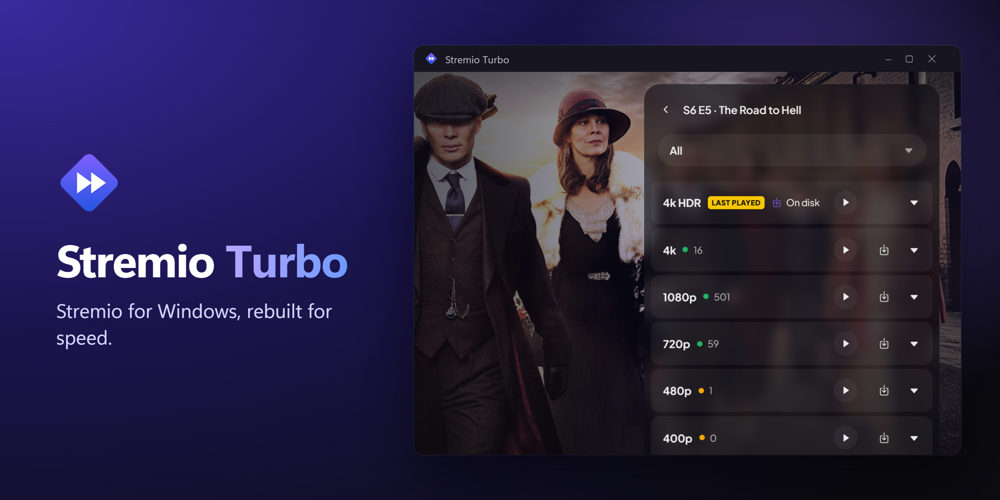
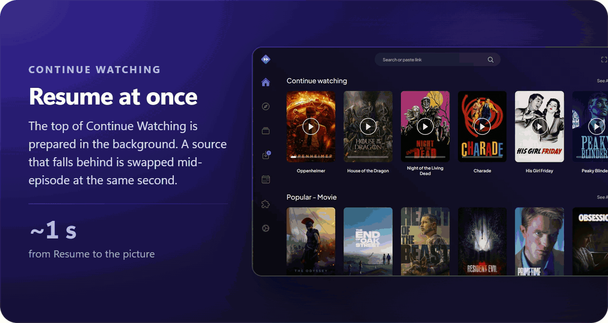
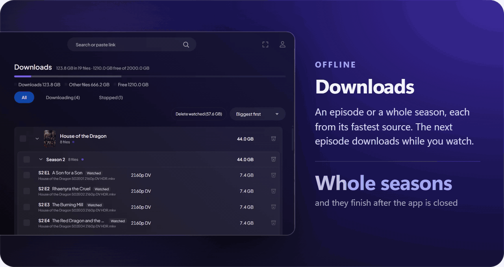
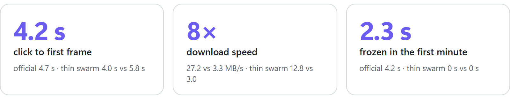

<p align="center">
  
</p>

<p align="center">
  <b>Stremio for Windows, rebuilt for speed.</b><br>
  It races the sources and plays the fastest one that keeps up, on a faster open-source torrent engine.
</p>

<p align="center">
  <a href="https://github.com/brunokinast/stremio-turbo/releases/latest"></a>
  <a href="https://github.com/brunokinast/stremio-turbo/actions/workflows/ci.yml"></a>
  
  
</p>

<hr>

<p align="center">
  <a href="https://github.com/brunokinast/stremio-turbo/releases/latest/download/StremioTurbo-x64.exe"></a>
</p>

<p align="center"><sub>Windows Defender may flag the installer: it isn't code-signed yet. The app updates itself, and every update is verified.<br><a href="#how-its-built">How it's built ↓</a></sub></p>

<hr>

<br>

## Features

<picture>
  <source media="(prefers-color-scheme: dark)" srcset="docs/readme/card-race-dark.gif">
  
</picture>

<picture>
  <source media="(prefers-color-scheme: dark)" srcset="docs/readme/card-engine-dark.png">
  
</picture>

<picture>
  <source media="(prefers-color-scheme: dark)" srcset="docs/readme/card-resume-dark.gif">
  
</picture>

<picture>
  <source media="(prefers-color-scheme: dark)" srcset="docs/readme/card-downloads-dark.gif">
  
</picture>

<br>

## How fast

<picture>
  <source media="(prefers-color-scheme: dark)" srcset="docs/readme/stats-dark.png">
  
</picture>

On a thin swarm (about 40 peers) Turbo starts in **4.0 s** against the official app's 5.8 s, and downloads at 12.8 MB/s against 3.0 (qBittorrent 7.5).

<sub>Median of 6 runs per client, each starting fresh with nothing cached, in rotating order; the same player (the app's mpv) plays for Stremio and Turbo. qBittorrent has no player: its line is the same torrent downloading.</sub>

<details>
<summary><b>Every run, and how fair the test is</b></summary>

**How it ran.** One PC and one home connection; one client at a time, each started fresh, given 10 s to warm up (DHT, trackers), then 60 s from the click; the order rotates each round so no client always goes first. Every client gets the same torrent and the same tracker list, and its download is deleted after each run.

- **Stremio** 5.0.28 (server 4.22.6) runs with this PC's own settings, which are its fastest torrent profile: 200 connections, and its built-in throttle that stops looking for peers above 4 MiB/s.
- **Turbo** 1.0.2's engine runs exactly as the app starts it.
- **qBittorrent** 5.1.2 runs with stock settings, plus sequential download and first and last pieces first, as streaming needs.

**What to keep in mind.**

- qBittorrent's "first frame" is a stand-in (the file's first and last pieces on disk), not a played frame.
- qBittorrent's speed swings with whether it reaches one fast seedbox. Over 12 other rounds the same day its median from 30 s on was 25 MB/s, against Turbo's 34 ( [finding 45](research/findings/45-steady-state-speed.md)). Turbo's lead is real but smaller than this run's.
- The official app always ran first in round 1, and both times that was its slowest run. Without it, its medians move by only 0.1 MB/s.
- Two torrents on one connection. Turbo's latest speed fixes were measured on the healthy one; the thin one wasn't used to tune anything.

Every run below, anonymised (no torrent, addresses or names). With each second's download: [docs/readme/bench-runs.json](docs/readme/bench-runs.json). The script: [research/lab/bench/compare.py](research/lab/bench/compare.py).

<!-- bench-runs:start -->

**Healthy swarm** (179–292 peers known)

| Round · order | Client | First frame | Frozen | MB/s | 0–30 s | 30–60 s | Peak | Peers |
|---|---|--:|--:|--:|--:|--:|--:|--:|
| 1 · 1 | Stremio | 14.2 s | 5 × 28.4 s | 1.1 | 1.2 | 1.0 | 1.9 | 12 |
| 1 · 2 | Turbo | 4.3 s | 1 × 4.2 s | 21.0 | 16.3 | 25.5 | 35.1 | 39 |
| 1 · 3 | qBittorrent | not ready | – | 16.3 | 12.0 | 20.0 | 26.1 | 37 |
| 2 · 1 | Turbo | 4.7 s | 2 × 4.5 s | 27.8 | 21.1 | 34.4 | 41.5 | 39 |
| 2 · 2 | qBittorrent | 21.0 s* | – | 16.1 | 13.8 | 17.8 | 21.8 | 34 |
| 2 · 3 | Stremio | 4.3 s | 3 × 4.1 s | 4.2 | 3.5 | 4.8 | 6.0 | 11 |
| 3 · 1 | qBittorrent | 15.0 s* | – | 16.3 | 13.4 | 18.5 | 26.4 | 27 |
| 3 · 2 | Stremio | 4.6 s | 3 × 4.2 s | 3.4 | 2.8 | 4.1 | 5.2 | 12 |
| 3 · 3 | Turbo | 4.0 s | 1 × 2.6 s | 24.4 | 20.3 | 28.4 | 45.1 | 35 |
| 4 · 1 | Stremio | 4.6 s | 4 × 11.8 s | 3.0 | 2.9 | 3.1 | 4.0 | 15 |
| 4 · 2 | Turbo | 4.0 s | 1 × 1.6 s | 31.9 | 24.7 | 39.0 | 41.7 | 36 |
| 4 · 3 | qBittorrent | not ready | – | 15.2 | 12.6 | 17.4 | 40.2 | 29 |
| 5 · 1 | Turbo | 4.5 s | 1 × 2.0 s | 26.5 | 18.1 | 34.9 | 39.6 | 36 |
| 5 · 2 | qBittorrent | not ready | – | 15.5 | 14.3 | 16.2 | 18.4 | 29 |
| 5 · 3 | Stremio | 4.7 s | 1 × 2.1 s | 4.0 | 3.6 | 4.3 | 4.7 | 14 |
| 6 · 1 | qBittorrent | not ready | – | 12.3 | 13.2 | 11.0 | 17.2 | 25 |
| 6 · 2 | Stremio | 4.8 s | 2 × 3.6 s | 3.2 | 3.2 | 3.3 | 4.6 | 12 |
| 6 · 3 | Turbo | 3.8 s | 1 × 1.1 s | 30.2 | 22.8 | 37.6 | 53.0 | 33 |

**Thin swarm** (37–43 peers known)

| Round · order | Client | First frame | Frozen | MB/s | 0–30 s | 30–60 s | Peak | Peers |
|---|---|--:|--:|--:|--:|--:|--:|--:|
| 1 · 1 | Stremio | 5.0 s | 0 | 1.7 | 2.2 | 1.2 | 2.7 | 5 |
| 1 · 2 | Turbo | 4.0 s | 0 | 13.4 | 13.5 | 13.3 | 19.7 | 8 |
| 1 · 3 | qBittorrent | 30.0 s* | – | 8.7 | 7.9 | 9.2 | 11.8 | 11 |
| 2 · 1 | Turbo | 4.6 s | 0 | 9.9 | 9.0 | 10.7 | 14.9 | 10 |
| 2 · 2 | qBittorrent | 38.0 s* | – | 6.9 | 6.3 | 7.3 | 8.9 | 11 |
| 2 · 3 | Stremio | 5.8 s | 0 | 4.2 | 4.0 | 4.5 | 4.9 | 6 |
| 3 · 1 | qBittorrent | 38.0 s* | – | 6.4 | 7.1 | 5.6 | 9.6 | 10 |
| 3 · 2 | Stremio | 5.8 s | 0 | 3.4 | 2.6 | 4.2 | 4.4 | 6 |
| 3 · 3 | Turbo | 4.9 s | 0 | 11.3 | 9.6 | 13.0 | 15.9 | 10 |
| 4 · 1 | Stremio | 8.4 s | 0 | 3.0 | 2.6 | 3.3 | 3.9 | 6 |
| 4 · 2 | Turbo | 3.9 s | 0 | 16.4 | 15.2 | 17.7 | 22.5 | 10 |
| 4 · 3 | qBittorrent | 21.0 s* | – | 8.6 | 9.5 | 7.4 | 12.2 | 11 |
| 5 · 1 | Turbo | 4.0 s | 0 | 12.2 | 10.6 | 13.8 | 18.8 | 12 |
| 5 · 2 | qBittorrent | not ready | – | 5.8 | 5.4 | 6.0 | 9.0 | 10 |
| 5 · 3 | Stremio | 5.5 s | 0 | 2.5 | 2.6 | 2.3 | 3.1 | 5 |
| 6 · 1 | qBittorrent | 15.0 s* | – | 8.1 | 7.0 | 8.9 | 12.9 | 11 |
| 6 · 2 | Stremio | 5.7 s | 0 | 3.1 | 2.7 | 3.4 | 4.4 | 6 |
| 6 · 3 | Turbo | 3.9 s | 0 | 15.2 | 13.7 | 16.8 | 20.9 | 11 |

<sub>Order: when the client ran within its round. Frozen: the player's pauses for data after the first frame, count × total. MB/s: the average over the 60 s; Peak: the best second. Peers: most connected at once. *qBittorrent has no player: its first frame is when the first and last pieces are on disk (the file's headers and index), "not ready" if not within 60 s.</sub>

<!-- bench-runs:end -->

</details>

<br>

## How it's built

Every layer of Stremio, forked, improved and bundled into one installer.

<picture>
  <source media="(prefers-color-scheme: dark)" srcset="docs/readme/stack-dark.png">
  
</picture>

**A few decisions worth a look**

- **Fix the cause in the layer that owns it.** No patch scripts or runtime workarounds: each change is a normal commit in its fork. ([UPSTREAMS.md](UPSTREAMS.md))
- **Prove it in a lab first.** A 150 ms relay with a real libtorrent sender showed uTP's 30-packet selective ack freezing a stream once per lost packet; acking the whole reorder buffer removed it. ([lab](research/findings/10-lab-results.md), [fix](research/findings/12-transport-fixes.md))
- **Only the player's bytes are urgent.** The chunks mpv needs are asked for first, by deadline, and taken from a slow peer once overdue. ([start-up reads](research/findings/14-startup-reads.md), [critical chunks](research/findings/15-critical-chunks.md))
- **One health rule for every choice.** 1.25× playback speed picks the source, prepares the next episode, triggers a switch and chooses download sources. ([the picker](research/findings/36-one-picker-next-slot-switching.md))

**Always ahead of the official app.** A release can't be built until every original project's latest code is merged and every test passes ([scripts/release.ps1](scripts/release.ps1)).

**Quality.** About 2,200 tests (Jest, Go, Rust) before every commit; 44 findings documents with before-and-after numbers.

**Stack.** Go · Rust · React · TypeScript · WebView2 · mpv · anacrolix/torrent · Inno Setup · GitHub Actions

<br>

## Build it

Needs Node.js 24 (corepack), Go, Rust (MSVC) and Inno Setup 6.

```
pwsh scripts/build.ps1           # installer and signed update files in out/
pwsh scripts/dev.ps1             # the app against the web dev server
pwsh scripts/sync-upstreams.ps1  # merge every original project's latest code
```

Each folder keeps its project's licence (`web/` GPL-2.0, `server/` MIT, `deps/` MPL-2.0; Stremio's shell states none), and the rest of the repository is GPL-2.0: see [NOTICE.md](NOTICE.md) and [LICENSE](LICENSE). Upstreams and how to sync them: [UPSTREAMS.md](UPSTREAMS.md).

<br>

<p align="center"><sub>Unofficial: not affiliated with Stremio. Stremio Turbo ships no content; what you can watch comes from the add-ons you install.<br>Made by <a href="https://github.com/brunokinast">Bruno Kinast</a></sub></p>
