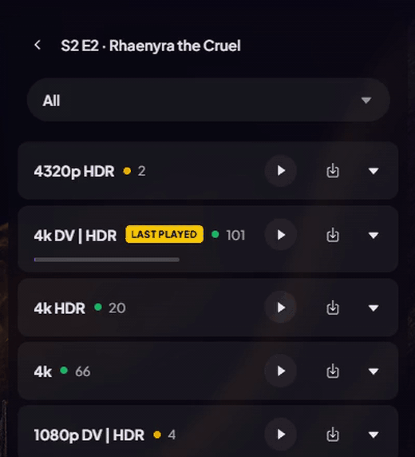
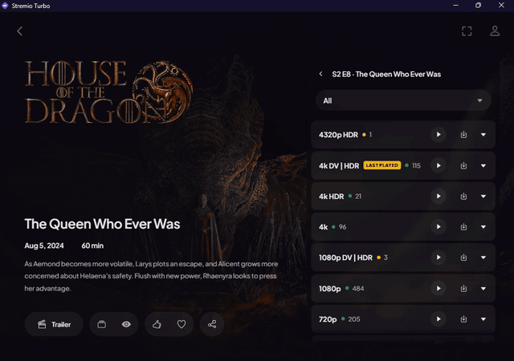
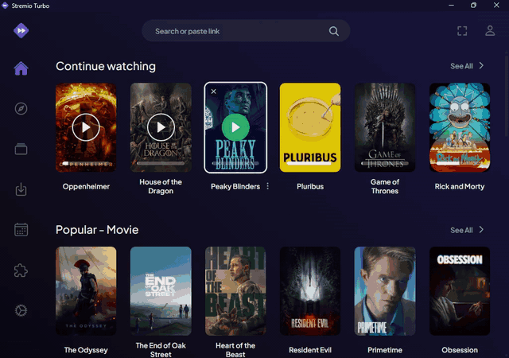
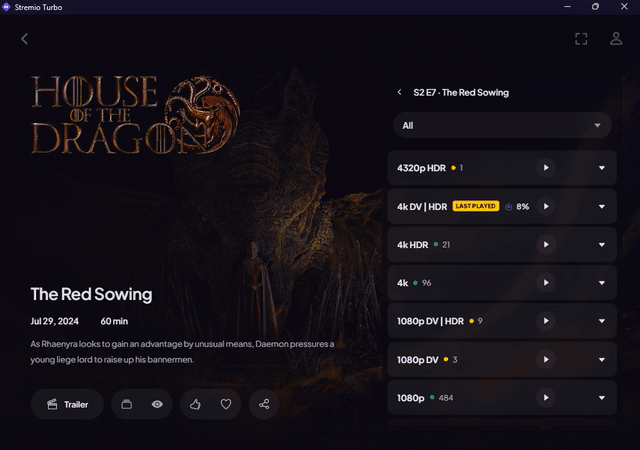
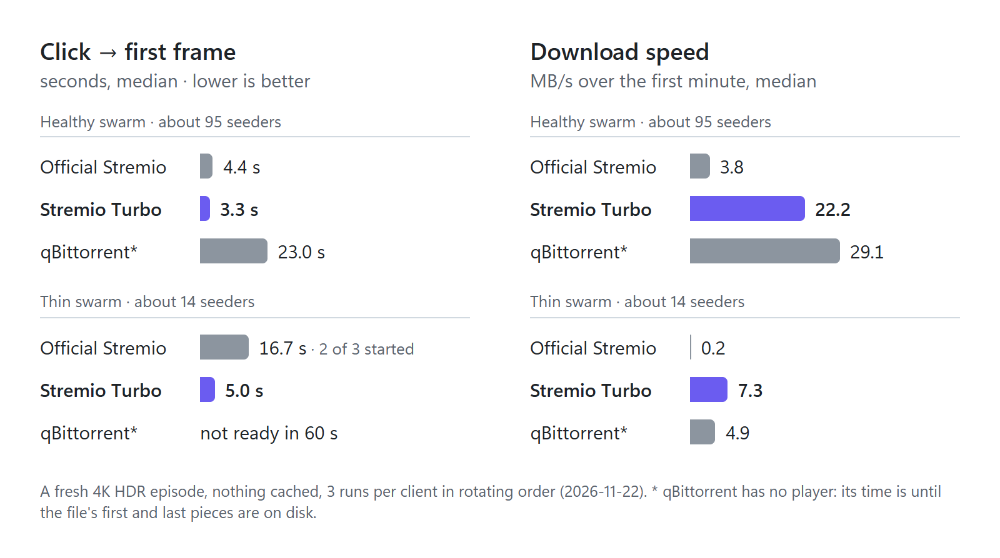
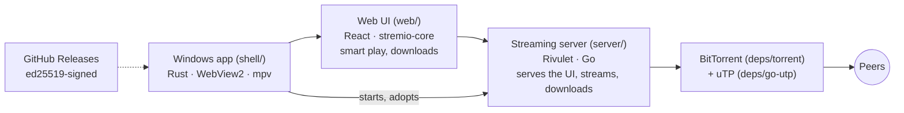

<!-- DRAFT (branch `readme`): images from scripts/readme-images.mjs; numbers from research/lab/bench (2026-11-22). -->

<p align="center">
  
</p>

<p align="center">
  <b>Stremio for Windows, rebuilt for speed: 4K HDR starts in seconds and doesn't buffer.</b><br>
  It races the sources and plays the fastest one that keeps up, on a faster open-source torrent engine.
</p>

<p align="center">
  <a href="https://github.com/brunokinast/stremio-turbo/releases/latest"></a>
  <a href="https://github.com/brunokinast/stremio-turbo/actions/workflows/release.yml"></a>
  
  
</p>

<hr>

<p align="center">
  <a href="https://github.com/brunokinast/stremio-turbo/releases/latest/download/StremioTurbo-x64.exe"></a>
</p>

<p align="center"><sub>Not code-signed yet: on “Windows protected your PC”, choose More info → Run anyway. The app updates itself, and every update is checked against this project's signing key.<br><a href="#how-its-built">How it's built ↓</a></sub></p>

<hr>

<br>

## Features

<table>
  <tr>
    <td width="50%" valign="top">
      <br><br>
      <b>Races the sources</b><br>
      The top three sources of a quality are tested live, and the best picture that keeps up plays (at least 1.25× the speed it needs). If none does, it steps down a quality and says why. The test starts while you read the page, so Play is usually instant.
    </td>
    <td width="50%" valign="top">
      <br><br>
      <b>A faster torrent engine</b><br>
      Fixes in the uTP transport, the request queue, storage and peer dialling, each measured before and after. A fresh 4K HDR episode downloads 6× faster than in the official app, and on a thin swarm it starts in 5 s where the official app took 17 s or never started.
    </td>
  </tr>
  <tr>
    <td valign="top">
      <br><br>
      <b>Resume at once, no buffering</b><br>
      The top of Continue Watching is prepared in the background, so Resume plays in about 2 s. A source that falls behind is swapped mid-episode at the same second, with a 0.3 s gap.
    </td>
    <td valign="top">
      <br><br>
      <b>Downloads</b><br>
      An episode or a whole season, each from its fastest source. The next episode downloads while you watch, and downloads finish after the app is closed.
    </td>
  </tr>
</table>

<br>

## How fast

<picture>
  <source media="(prefers-color-scheme: dark)" srcset="docs/readme/bench-dark.png">
  
</picture>

| A fresh 4K HDR episode, median of 3 runs (range) | Official Stremio | Stremio Turbo | qBittorrent* |
| ------------------------------------------------ | ---------------: | ------------: | -----------: |
| **Healthy swarm** (9.0 GB, about 95 seeders) | | | |
| Click → first frame | 4.4 s (4.3–4.7) | **3.3 s** (2.7–3.6) | 23 s (21–39) |
| Download speed, first 60 s | 3.8 MB/s | **22.2 MB/s** (19.8–23.0) | 29.1 MB/s (12.5–37.4) |
| Time frozen in the first minute | 7.2 s (4.1–9.3) | **0.5 s** (0–0.6) | — |
| **Thin swarm** (8.6 GB, about 14 seeders) | | | |
| Click → first frame | 16.7 s; 1 of 3 never | **5.0 s** (4.9–7.1) | 51 s; 2 of 3 never |
| Download speed, first 60 s | 0.2 MB/s | **7.3 MB/s** (1.9–9.5) | 4.9 MB/s (3.7–6.6) |
| Time frozen in the first minute | 6.4 s (0–13.1) | **0 s** | — |

<sub>* qBittorrent has no player: its time is until the first and last pieces are on disk, what a player needs before its first frame. Each client starts fresh with nothing cached, in rotating order; the same player (the app's mpv) plays for Stremio and Turbo. Script and raw numbers: [research/lab/bench](research/lab/bench).</sub>

<br>

## How it's built

Stremio's Windows app and web UI, with the closed-source streaming server replaced by an open one. Every layer is a folder in this repository, so a fix lands where the cause is: the UI, the server, the BitTorrent library or the uTP transport.



**A few decisions worth a look**

- **Own every layer, and fix the cause where it lives.** Stremio's closed `server.js` was replaced by Rivulet, and the app, the BitTorrent library and the uTP transport were forked in too. No patch scripts or runtime workarounds: each change is a normal commit in the layer that owns the problem. ([UPSTREAMS.md](UPSTREAMS.md))
- **Prove it in a lab first.** A relay that adds 150 ms of latency, with a real libtorrent sender, showed that the uTP receiver's 30-packet selective ack freezes a stream for one round trip per lost packet. Acking the whole reorder buffer removed the freezes, in the lab and then on real swarms. ([lab results](research/findings/10-lab-results.md), [the fix](research/findings/12-transport-fixes.md))
- **Only the player's bytes are urgent.** mpv needs under 1 MiB before its first frame, so those chunks are asked for first, ordered by when they're needed, and taken from a slow peer once overdue. ([start-up reads](research/findings/14-startup-reads.md), [critical chunks](research/findings/15-critical-chunks.md))
- **One health rule for every choice.** A source is healthy when it downloads at least 1.25× faster than playback needs. The same rule picks the source, prepares the next episode, triggers a mid-episode switch and chooses download sources. ([the picker](research/findings/36-one-picker-next-slot-switching.md))

**Always ahead of the official app.** A release can't be built until the latest code of every original project is merged and every test passes ([scripts/release.ps1](scripts/release.ps1)). A daily job opens an issue when one of them moves.

**Quality.** About 2,200 tests across the web UI (Jest), the server and libraries (Go) and the app (Rust), run before every commit. 43 findings documents record each change with numbers from before and after. Built with Claude Code from written plans, one measured step at a time.

**Stack.** Go · Rust · React · TypeScript · WebView2 · mpv · anacrolix/torrent · Inno Setup · GitHub Actions

<br>

## Build it

Needs Node.js 24 (corepack), Go, Rust (MSVC) and Inno Setup 6.

```
pwsh scripts/build.ps1           # installer and signed update files in out/
pwsh scripts/dev.ps1             # the app against the web dev server
pwsh scripts/sync-upstreams.ps1  # merge every original project's latest code
```

Each folder keeps its project's licence: `web/` GPL-2.0, `server/` MIT, `deps/` MPL-2.0; `shell/` comes from Stremio's stremio-shell-ng, which states none. Upstreams and how to sync them: [UPSTREAMS.md](UPSTREAMS.md).

<br>

<p align="center"><sub>Unofficial: not affiliated with Stremio. Stremio Turbo ships no content; what you can watch comes from the add-ons you install.<br>Made by <a href="https://github.com/brunokinast">Bruno Kinast</a></sub></p>
